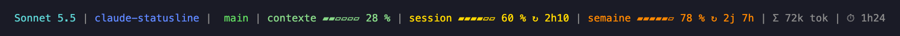

# claude-statusline

Une status line colorée pour [Claude Code](https://claude.com/claude-code) : modèle, dossier, branche git, fenêtre de contexte, limites d'utilisation et tokens, sur une seule ligne.

```
Sonnet 5.5 | monprojet |  main* | contexte ▰▰▱▱▱▱ 28 % | session ▰▰▰▰▱▱ 60 % ↻ 2h09 | semaine ▰▰▰▰▰▱ 90 % ↻ 2j 7h | Σ 72k tok | ⏱ 1h24
```



> 🇬🇧 English guide: [README.md](README.md)

## Ce qui est affiché

- **Modèle** actif (cyan) et **dossier** courant (bleu).
- **Branche git** (vert), avec un `*` rouge si le dépôt a des modifications. Rien hors d'un dépôt git.
- **contexte** : part de la fenêtre de contexte utilisée.
- **session** : limite de la fenêtre de 5 heures, avec le temps avant réinitialisation (`↻`).
- **semaine** : limite de la fenêtre de 7 jours, avec le temps avant réinitialisation (`↻`).
- **Σ** : cumul des tokens de la session (entrée + sortie + écriture dans le cache ; les lectures de cache ne sont pas comptées).
- **⏱** : durée de la session.

Chaque barre (6 segments) et son texte changent de couleur selon l'utilisation :

| Utilisation | Couleur |
|---|---|
| 0 à 49 % | vert |
| 50 à 69 % | jaune |
| 70 à 84 % | orange |
| 85 % et plus | rouge |

Les couleurs sont des teintes 256 couleurs fixes, donc indépendantes du thème du terminal. Les éléments `session`, `semaine` et `↻` n'apparaissent que si Claude Code envoie ces données (abonnements Pro et Max). Sans elles, ils sont simplement omis.

## Installation

Prérequis : `bash` et, idéalement, [`jq`](https://jqlang.org/). Sans `jq`, seuls le modèle, le dossier, la branche et le contexte sont affichés.

```bash
git clone https://github.com/AnthonyDpz/claude-statusline.git
cd claude-statusline
mkdir -p ~/.claude
cp statusline.sh ~/.claude/statusline.sh
chmod +x ~/.claude/statusline.sh
```

Puis ajoutez ceci dans `~/.claude/settings.json` :

```json
{
  "statusLine": {
    "type": "command",
    "command": "~/.claude/statusline.sh"
  }
}
```

La status line apparaît après le prochain message, ou au redémarrage de la session.

## Test rapide

```bash
echo '{"model":{"display_name":"Sonnet 5.5"},"context_window":{"used_percentage":42}}' | ./statusline.sh
```

## Personnalisation

Les seuils de couleur sont dans la fonction `segment`, et la largeur des barres dans la variable `width`. Les libellés (`contexte`, `session`, `semaine`) sont de simples chaînes en bas du script.

## Confidentialité et sécurité

Le script lit uniquement le JSON envoyé par Claude Code sur l'entrée standard et le fichier de session vers lequel il pointe. Il n'envoie rien sur le réseau et n'écrit qu'un petit fichier de cache (`claude-statusline-tokens-*` dans votre dossier temporaire) contenant des nombres de tokens. `git status` s'exécute avec `core.fsmonitor=false` : ouvrir un dépôt non fiable ne peut pas lancer de commande définie dans sa configuration git.

## Soutien

claude-statusline est gratuit et open source. S'il vous est utile, vous pouvez [parrainer le projet sur GitHub](https://github.com/sponsors/AnthonyDpz) ☕

## Licence

MIT — voir [LICENSE](LICENSE).
