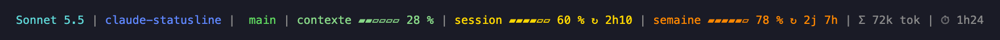

# claude-statusline

A colourful status line for [Claude Code](https://claude.com/claude-code): model, folder, git branch, context window, usage limits and tokens, all on one line.

```
Sonnet 5.5 | myproject |  main* | contexte ▰▰▱▱▱▱ 28 % | session ▰▰▰▰▱▱ 60 % ↻ 2h09 | semaine ▰▰▰▰▰▱ 90 % ↻ 2j 7h | Σ 72k tok | ⏱ 1h24
```



> 🇫🇷 Guide en français : [LISEZMOI.md](LISEZMOI.md)

## Features

- **Model** (cyan) and **current folder** (blue).
- **Git branch** (green), with a red `*` when the repository has changes. Nothing outside a git repository.
- **Context window** (`contexte`): share of the context window in use.
- **Session** (`session`): your 5-hour usage limit, with the time left before it resets (`↻`).
- **Week** (`semaine`): your 7-day usage limit, with the time left before it resets (`↻`).
- **Tokens** (`Σ`): total tokens used in the session (input + output + cache writes; cache reads are not counted).
- **Duration** (`⏱`): how long the session has been running.

Each bar (6 segments) and its text change colour with usage:

| Usage | Colour |
|---|---|
| 0 – 49 % | green |
| 50 – 69 % | yellow |
| 70 – 84 % | orange |
| 85 % and above | red |

Colours are fixed 256-colour values, so they do not depend on your terminal theme. The `session`, `semaine` and `↻` parts only appear when Claude Code sends that data (Pro and Max plans); otherwise they are simply left out.

## Install

Requires `bash` and, ideally, [`jq`](https://jqlang.org/). Without `jq` only the model, folder, branch and context are shown.

```bash
git clone https://github.com/AnthonyDpz/claude-statusline.git
cd claude-statusline
mkdir -p ~/.claude
cp statusline.sh ~/.claude/statusline.sh
chmod +x ~/.claude/statusline.sh
```

Then add this to `~/.claude/settings.json`:

```json
{
  "statusLine": {
    "type": "command",
    "command": "~/.claude/statusline.sh"
  }
}
```

The status line appears after your next message, or when the session restarts.

### Windows

Use [Git for Windows](https://gitforwindows.org/) (it provides `bash`), then install `jq` from PowerShell:

```powershell
winget install jqlang.jq
```

Restart your terminal afterwards so `jq` is picked up in the `PATH`. Copy the script into `%USERPROFILE%\.claude\` (e.g. `git clone` then `cp statusline.sh ~/.claude/` from Git Bash) and call it through `bash` in `%USERPROFILE%\.claude\settings.json`:

```json
{
  "statusLine": {
    "type": "command",
    "command": "bash ~/.claude/statusline.sh"
  }
}
```

## Try it

```bash
echo '{"model":{"display_name":"Sonnet 5.5"},"context_window":{"used_percentage":42}}' | ./statusline.sh
```

## Customise

Colour thresholds are in the `segment` function and the bar width is the `width` variable. The labels (`contexte`, `session`, `semaine`) are plain strings at the bottom of the script.

## Privacy and security

The script only reads the JSON that Claude Code sends on stdin and the session transcript file it points to. It sends nothing over the network and writes only a small cache file (`claude-statusline-tokens-*` in your temporary folder) holding token counts. `git status` runs with `core.fsmonitor=false`, so opening an untrusted repository cannot run commands from its git config.

## Support

claude-statusline is free and open source. If it is useful to you, you can [sponsor the project on GitHub](https://github.com/sponsors/AnthonyDpz) ☕

## License

MIT — see [LICENSE](LICENSE).
